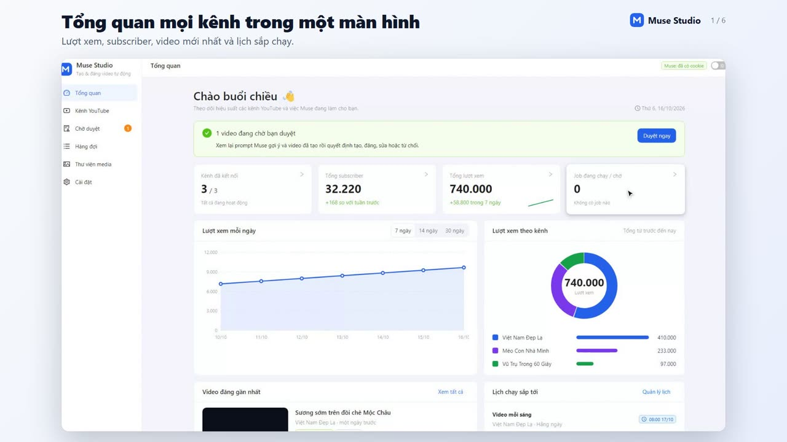

# Muse Studio

Công cụ chạy trên máy cá nhân để **tạo video bằng tài khoản Muse (muse.ai), duyệt rồi đăng tự động lên nhiều kênh YouTube**.

- Mỗi kênh YouTube là một project riêng với chủ đề/ngách của nó. Muse tự gợi ý prompt cho từng video, bạn duyệt rồi mới tạo video.
- Đặt lịch hằng ngày: Muse tự nghĩ prompt và tạo video, hoặc dùng prompt/video bạn đã chuẩn bị.
- Video tạo xong vào hộp **Chờ duyệt**; chỉ khi bạn duyệt mới đăng lên YouTube (có tùy chọn tự đăng).
- Theo dõi lượt xem, subscriber, số liệu từng video của mọi kênh trong một bảng điều khiển.

Không cần Docker, Python hay cơ sở dữ liệu. Server chỉ dùng Node.js, không có thư viện nào cần cài để chạy.

## Video demo

[](docs/demo.mp4)

Bấm vào ảnh để xem video demo (khoảng 1 phút 40 giây, dùng dữ liệu giả).

## Yêu cầu

| Thứ cần có | Ghi chú |
|---|---|
| **Node.js 22 trở lên** | Hướng dẫn cài ở bên dưới. Server dùng `fetch` và `WebSocket` có sẵn của Node 22. |
| **Google Chrome hoặc Microsoft Edge** | Tool điều khiển trình duyệt này để làm việc với muse.ai. Windows/macOS/Linux đều được. |
| **Tài khoản Muse** | Đăng nhập được trên muse.ai. |
| **Tài khoản Google quản lý kênh YouTube** | Và một Google OAuth client do bạn tự tạo (làm một lần, có hướng dẫn trong giao diện). |
| Máy bật khi cần chạy lịch | Lịch chạy trên chính máy này. Nếu tắt máy đúng giờ chạy, lịch tự chạy bù khi bật lại trong cùng ngày. |

## Cài đặt và chạy (làm từng bước)

### Bước 1. Cài Node.js (chỉ làm một lần)

1. Kiểm tra máy đã có chưa: nhấn phím **Windows**, gõ **cmd**, nhấn Enter để mở cửa sổ dòng lệnh, rồi gõ:

   ```
   node -v
   ```

   - Hiện số phiên bản từ **v22** trở lên (ví dụ `v22.15.0`): đã đủ, sang Bước 2.
   - Hiện "node is not recognized" hoặc số nhỏ hơn 22: làm tiếp bước dưới.
2. Mở https://nodejs.org, bấm nút tải bản **LTS** (nút màu xanh), chạy file vừa tải, bấm **Next** đến hết và giữ nguyên các lựa chọn mặc định.
3. **Đóng cửa sổ cmd cũ, mở cửa sổ cmd mới** rồi gõ lại `node -v` để chắc chắn đã thấy số phiên bản.

Cần thêm **Google Chrome** hoặc **Microsoft Edge** (Windows thường có sẵn Edge).

### Bước 2. Tải mã nguồn về máy

- Cách dễ nhất: trên trang GitHub của dự án, bấm nút xanh **Code → Download ZIP**, rồi chuột phải file ZIP → **Extract All** (giải nén) vào một thư mục cố định, ví dụ `C:\MuseStudio`.
- Hoặc nếu có Git: `git clone <địa chỉ-repo> C:\MuseStudio`

Thư mục sau khi giải nén phải chứa trực tiếp file `server.js` và `Start.bat` (nếu thấy thêm một thư mục con trùng tên bên trong, hãy mở vào thư mục con đó).

### Bước 3. Chạy

**Cách A: bấm đúp (dễ nhất, chỉ Windows).** Bấm đúp file **`Start.bat`**. Tool chạy **nền, không hiện cửa sổ đen**; vài giây sau trình duyệt tự mở trang Muse Studio. Nếu chưa cài Node, file sẽ tự mở trang tải Node.js cho bạn. Bấm đúp `Start.bat` lần nữa khi tool đang chạy thì chỉ mở lại trang, không chạy trùng.

**Cách B: gõ lệnh (mọi hệ điều hành).**

1. Mở thư mục chứa `server.js` trong File Explorer, bấm vào **thanh địa chỉ** phía trên, gõ `cmd` rồi nhấn Enter. Cửa sổ cmd sẽ mở sẵn đúng thư mục đó. (Hoặc mở cmd rồi gõ `cd /d C:\MuseStudio`.)
2. Gõ lệnh:

   ```
   node server.js
   ```

3. Khi thấy dòng `Muse Studio chạy tại http://127.0.0.1:3000`, mở trình duyệt vào địa chỉ **http://127.0.0.1:3000** (gõ đúng `127.0.0.1`, không dùng `localhost`, vì địa chỉ này khớp với cấu hình đăng nhập Google).

Nếu chữ tiếng Việt trong cửa sổ cmd bị lỗi font (ký tự lạ), gõ `chcp 65001` rồi Enter trước khi chạy `node server.js`. Việc này không ảnh hưởng tới hoạt động của tool.

Trên Mac/Linux: mở Terminal, gõ `cd` tới thư mục dự án rồi chạy `node server.js`.

### Bật, tắt và mở lại

- **Tắt tool:** bấm đúp **`Stop.bat`**. File này tắt tool đang chạy nền và đóng luôn trình duyệt Chrome/Edge mà tool đã mở. (Nếu chạy bằng cách B ở trên thì bấm vào cửa sổ cmd rồi nhấn **Ctrl + C**.)
- **Mở lại lần sau:** bấm đúp `Start.bat`. Dữ liệu, cookie và kênh đã kết nối được giữ nguyên, không phải thiết lập lại.
- **Muốn tool tự chạy khi bật máy:** nhấn **Windows + R**, gõ `shell:startup`, Enter, rồi kéo một **shortcut** của `Start.bat` (chuột phải → Create shortcut) vào thư mục vừa mở. Tool sẽ chạy nền, không hiện cửa sổ.
- **Lịch tự động chỉ chạy khi máy đang bật** và tool đang chạy. Nếu máy tắt đúng giờ chạy, lịch tự chạy bù khi bạn bật lại trong cùng ngày.
- **Khi có lỗi:** tool chạy nền nên không thấy thông báo lỗi trên màn hình. Mở file `data\server-error.log` (lỗi) và `data\server.log` (nhật ký) để xem.
- **Cập nhật phiên bản mới:** chạy `Stop.bat`, tải ZIP mới, giải nén đè lên thư mục cũ nhưng **giữ lại thư mục `data`** (nơi lưu mọi dữ liệu của bạn), rồi chạy lại `Start.bat`.

## Thiết lập lần đầu (khoảng 10 phút)

### 1. Kết nối tài khoản Muse (trang Cài đặt → Tài khoản Muse)

Tool dùng cookie đăng nhập của bạn trên muse.ai.

1. Cài một extension quản lý cookie từ cửa hàng chính thức, ví dụ **Cookie-Editor** (Chrome Web Store / Edge Add-ons).
2. Đăng nhập muse.ai bằng Chrome/Edge như bình thường.
3. Ở trang muse.ai mở extension → **Export → JSON** (tự chép vào clipboard).
4. Quay lại Cài đặt, bấm **Dán từ clipboard**. Cần đủ 4 cookie: `hatch_sess`, `hatch_gw`, `hatch_vml`, `hatch_native_auth_device`. Bấm **Lưu cookie** rồi **Kiểm tra kết nối**.

Không muốn dùng extension: mở DevTools (F12) → tab Network → bấm một request tới muse.ai → sao chép giá trị dòng `cookie` ở Request Headers, dán nguyên chuỗi vào ô.

Lần chạy thật đầu tiên nên tắt tùy chọn "Ẩn cửa sổ trình duyệt" (Cài đặt → Trình duyệt tạo video) để quan sát cửa sổ Chrome/Edge tool mở ra.

> Cookie cho phép vào tài khoản Muse của bạn. Chỉ dán vào Cài đặt, không gửi qua chat hay email. Cookie hết hạn thì job dừng ở trạng thái **Cần cookie**; dán cookie mới là chạy tiếp.

### 2. Kết nối Google OAuth (trang Kênh YouTube, làm một lần)

Mở trang **Kênh YouTube**; nếu chưa cấu hình, trang hiện hướng dẫn 5 bước có link mở thẳng từng trang của Google. Tóm tắt:

1. Tạo project trên [Google Cloud Console](https://console.cloud.google.com/projectcreate).
2. Bật **YouTube Data API v3**.
3. Cấu hình màn hình đồng ý OAuth: loại **External**, thêm email các tài khoản quản lý kênh vào **Test users**, rồi chuyển sang **In production** (nếu để *Testing*, phiên đăng nhập YouTube hết hạn sau 7 ngày). Scope cần: `youtube.upload`, `youtube.readonly`.
4. Tạo **OAuth client ID** loại **Web application**, thêm vào *Authorized redirect URIs* đúng địa chỉ:
   `http://127.0.0.1:3000/oauth/youtube/callback`
   (đổi cổng nếu bạn chạy cổng khác).
5. Dán **Client ID** và **Client Secret** vào form trong giao diện.

Khi bấm **Kết nối YouTube** lần đầu, Google cảnh báo "ứng dụng chưa được xác minh" vì đây là ứng dụng của riêng bạn: chọn **Nâng cao → Tiếp tục**. Tài khoản có nhiều kênh sẽ hiện màn hình chọn đúng kênh cần kết nối.

Lỗi thường gặp: `redirect_uri_mismatch` (địa chỉ ở bước 4 chưa khớp từng ký tự), `access_denied` (email chưa nằm trong Test users).

### 3. Thêm kênh và điền chủ đề

1. **Kênh YouTube → Thêm kênh** → chọn tài khoản/kênh trên Google. Tên và avatar kênh tự lấy từ YouTube.
2. Tool chuyển thẳng sang trang kênh, tab **Hồ sơ kênh**: điền ngách, chủ đề, đối tượng, giọng điệu, điều cần tránh, khung hình và thời lượng mặc định. Muse dựa vào hồ sơ này để gợi ý prompt và đặt tiêu đề.

## Cách dùng hằng ngày

Trang của mỗi kênh có 5 tab: **Hồ sơ kênh · Prompt · Video · Lịch tự động · Bài đăng**.

**Làm tay:**
1. Tab **Prompt → Muse gợi ý prompt** (1–10 prompt, có thể kèm yêu cầu riêng). Prompt do Muse sinh ở trạng thái *Chờ duyệt*.
2. Sửa nội dung nếu muốn, bấm **Duyệt**. Prompt bạn tự viết hoặc nhập nhiều dòng thì đã duyệt sẵn.
3. Chọn các prompt đã duyệt → **Tạo video**. Khung hình/thời lượng lấy theo hồ sơ kênh. Hàng đợi chạy lần lượt từng video.
4. Video tạo xong vào mục **Chờ duyệt**, đã điền sẵn tiêu đề/mô tả/tag. Xem lại, sửa, chọn giờ đăng công khai rồi **Duyệt và upload**.

**Tự động bằng lịch (tab Lịch tự động → Thêm lịch):** chọn nguồn nội dung cho mỗi ngày:

| Nguồn | Hoạt động |
|---|---|
| **Muse tự nghĩ mỗi ngày** | Đến giờ, Muse nghĩ prompt mới theo hồ sơ kênh rồi tạo video. Không cần chuẩn bị gì. |
| **Prompt đã duyệt trong project** | Lấy lần lượt prompt đã duyệt. Tùy chọn Muse tự sinh thêm khi hết. |
| **Video đã tạo sẵn** | Chọn nhiều video có sẵn; mỗi ngày đưa một video vào duyệt/đăng. Hết video thì lịch tự tắt. |

Mặc định video do lịch tạo vẫn chờ bạn duyệt; có thể chọn *Tự đăng*. Nếu Muse lỗi, lịch thử lại sau 10 phút, tối đa 3 lần mỗi ngày, và báo lý do trong danh sách lịch.

## Lưu ý quan trọng

- **Hạn mức YouTube:** mỗi project Google có 10.000 đơn vị/ngày, mỗi lần upload tốn 1.600, tức khoảng 6 video mỗi ngày cho toàn bộ kênh. Trang Kênh hiển thị mức đã dùng.
- **Ứng dụng chưa được Google kiểm duyệt:** YouTube có thể khóa video upload ở chế độ riêng tư. Tool cảnh báo khi video đã đến giờ công khai mà vẫn riêng tư.
- **Quota Muse:** mỗi video và mỗi lần gợi ý prompt/tiêu đề tốn lượt dùng tài khoản Muse của bạn.
- **Dữ liệu và bảo mật:** mọi thứ nằm trong thư mục `data/` trên máy bạn, gồm cookie Muse, token YouTube và video. Server chỉ nhận kết nối từ máy này (`127.0.0.1`). **Không chia sẻ hoặc đưa `data/` lên git**; đã có sẵn trong `.gitignore`. Cookie và token lưu dạng văn bản trong thư mục này, hãy bảo vệ máy như bảo vệ tài khoản.
- Tool dùng giao diện web của Muse (tự động hóa trình duyệt), nên khi Muse đổi giao diện có thể cần chỉnh lại selector trong `lib/muse.js`. Hãy kiểm tra điều khoản của Muse và YouTube trước khi dùng thương mại.

## Trang giới thiệu và bán hàng

Thư mục `site/` là trang web giới thiệu tool (ảnh giao diện, video demo, hướng dẫn cài đặt, khung giá) kèm **thanh toán chuyển khoản tự động qua SePay**: khách trả tiền xong thì nút Tải về tự hiện ra. File bản cài **không nằm trong trang**; nó được giữ ở một repo riêng tư và chỉ phát cho đơn đã thanh toán.

- Hướng dẫn cấu hình từng bước (SePay, Upstash, Vercel, thử nghiệm): `site/HUONG-DAN-THANH-TOAN.md`.
- Cấu hình hiển thị (giá, liên hệ, tác giả): `site/site.config.js`.
- Đóng gói trang: `npm run site:build` → `site/dist/` (đưa nguyên thư mục này lên hosting, repo `muse-studio-landing`).
- Tạo file bản cài để bán: `node site/build.mjs --zip` → `site/release/muse-studio.zip`.
- Chạy thử toàn bộ luồng thanh toán bằng SePay giả: `node site/api/selftest.mjs`, hoặc `node site/dev.mjs` để xem trên trình duyệt.

## Cấu trúc

| Đường dẫn | Nội dung |
|---|---|
| `Start.bat`, `Stop.bat` | Bấm đúp để bật (chạy nền) / tắt trên Windows |
| `server.js` | HTTP server, API, hàng đợi, bộ lập lịch, đồng bộ số liệu YouTube |
| `lib/muse.js` | Điều khiển Chrome/Edge qua CDP để tạo video và chat với Muse |
| `lib/youtube.js` | OAuth nhiều kênh, upload, thống kê, theo dõi quota |
| `lib/ai.js` | Nhờ Muse gợi ý prompt theo hồ sơ kênh và tiêu đề/mô tả/tag |
| `web/` | Giao diện React + Ant Design (Vite). `web/src` là mã nguồn, `web/dist` là bản build |
| `site/` | Trang web giới thiệu và tải về (xem mục trên) |
| `data/` | Dữ liệu cục bộ, tự tạo khi chạy (không đưa vào git) |
| `Dockerfile` | Chỉ để phục vụ giao diện/API; tạo video cần Chrome/Edge nên chạy trực tiếp trên máy |

## Biến môi trường (tùy chọn)

| Biến | Mặc định | Ý nghĩa |
|---|---|---|
| `PORT` | `3000` | Cổng web. Đổi cổng thì phải đổi cả redirect URI trong Google Cloud |
| `HOST` | `127.0.0.1` | Địa chỉ lắng nghe |
| `DATA_DIR` | `./data` | Nơi lưu dữ liệu |
| `MUSE_BROWSER_PATH` | tự tìm | Đường dẫn Chrome/Edge nếu tool không tự tìm thấy |
| `OAUTH_REDIRECT_BASE` | `http://127.0.0.1:<PORT>` | Địa chỉ gốc của redirect OAuth (khi chạy sau proxy) |
| `ALLOWED_HOSTS` | | Thêm tên host được phép truy cập (phân tách bằng dấu phẩy) |
| `MUSE_CDP_PORT` | `19210` | Cổng gỡ lỗi của trình duyệt do tool mở |
| `MUSE_CHAT_THREAD_LIMIT` | `14` | Số tin tối đa trong một cuộc chat Muse trước khi mở cuộc mới |
| `SCHEDULE_TICK_MS` | `30000` | Chu kỳ kiểm tra lịch |

Các biến còn lại (`MUSE_SITE_URL`, `GOOGLE_*`, `YT_*`, `AVATAR_EXTRA_HOSTS`, `MUSE_THREAD_LOAD_TIMEOUT_MS`) chỉ dùng cho kiểm thử với dịch vụ giả.

## Phát triển

```bash
npm run setup     # lần đầu: cài thư viện giao diện và build
npm run build     # build lại sau khi sửa web/src
npm run dev:web   # giao diện hot reload ở cổng 5173 (cần server đang chạy ở cổng 3000)
npm run check     # kiểm tra cú pháp phần server
```


## Xử lý sự cố

| Hiện tượng | Cách xử lý |
|---|---|
| `Không tìm thấy Chrome/Edge` | Cài Chrome hoặc Edge, hoặc đặt `MUSE_BROWSER_PATH` |
| Job báo **Cần cookie** | Cookie Muse hết hạn: dán cookie mới ở Cài đặt |
| Mở trang bị 403 | Dùng đúng `http://127.0.0.1:3000`, hoặc thêm host vào `ALLOWED_HOSTS` |
| Kết nối YouTube báo `redirect_uri_mismatch` | Redirect URI trong Google Cloud phải khớp từng ký tự (http, 127.0.0.1, đúng cổng) |
| Kênh báo "Cần kết nối lại" | Token YouTube hết hạn hoặc bị thu hồi: bấm **Kết nối lại** |
| Lịch không chạy | Máy phải bật, có cookie Muse và kênh đã kết nối YouTube; xem dòng lỗi dưới tên lịch |
| Cổng 3000 bị chiếm (báo `EADDRINUSE`) | Tool đang chạy ở một cửa sổ khác, hãy đóng cửa sổ đó. Hoặc dùng cổng khác: trong cmd gõ `set PORT=3100` rồi `node server.js` (PowerShell: `$env:PORT=3100; node server.js`) và đổi redirect URI trong Google Cloud tương ứng |
| `'node' is not recognized` | Chưa cài Node.js, hoặc cài xong chưa mở lại cmd. Làm lại Bước 1 |
| Bấm `Start.bat` mà trình duyệt không mở được trang | Mở file `data\server-error.log` xem lỗi, hoặc mở cmd trong thư mục rồi gõ `node server.js` để thấy lỗi trực tiếp |
| Muốn đổi cổng khi dùng `Start.bat`/`Stop.bat` | Đặt biến `PORT` (ví dụ `set PORT=3100`) trước khi bấm, hoặc chạy hai file này từ cmd |
| Báo cần Node 22 | Tải bản LTS mới nhất tại nodejs.org rồi chạy lại |
